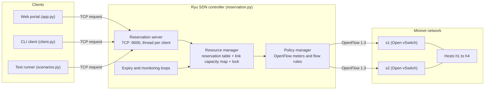
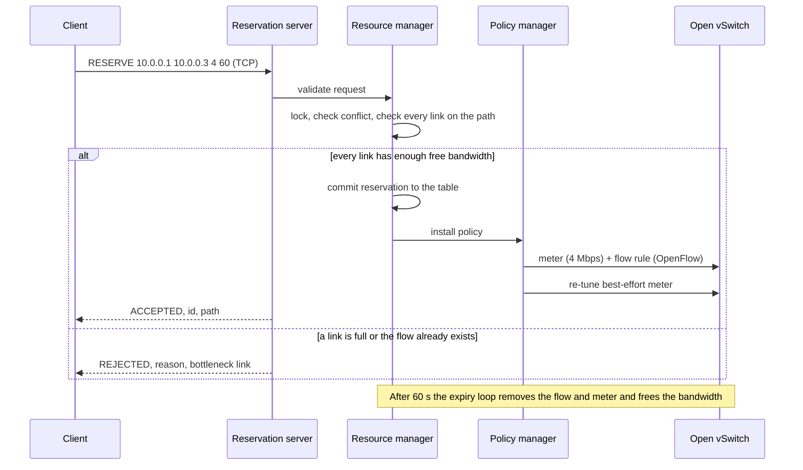

# Project Architecture and Design

Network Resource Reservation System: a TCP-based bandwidth reservation service integrated with a
Ryu SDN controller, Open vSwitch and Mininet. See [README.md](README.md) for setup and usage.

This document describes the components, network topology, request flow, application protocol,
admission control, concurrency handling and SDN policy design.

## 1. Components



| Component | File | Role |
|---|---|---|
| Client | `client.py`, web portal | Sends reservation requests over TCP |
| Reservation server | `reservation.py` | Accepts connections, parses commands, replies with JSON |
| Resource manager | `reservation.py` | Validates requests, keeps the table and link map, performs atomic admission |
| Policy manager | `reservation.py` | Builds and removes meters and flow rules |
| Ryu controller | `reservation.py` | SDN control plane, speaks OpenFlow 1.3 to the switches |
| Open vSwitch | Mininet | Programmable data plane that enforces meters and flows |
| Mininet topology | `topology.py` | Creates the virtual network |
| Web portal | `app.py` | Dashboard, scenarios, iPerf3 integration |
| Test runner | `scenarios.py` | Runs scenarios from the command line and saves CSV results |
| iPerf3 | external tool | Measures the real throughput delivered to each flow |

## 2. Network topology

```
   h1 (10.0.0.1) --10M--+                          +--10M-- h3 (10.0.0.3)
                         s1 ========10M======== s2
   h2 (10.0.0.2) --10M--+                          +--10M-- h4 (10.0.0.4)
```

Every link is 10 Mbps in each direction (`LINK_CAPACITY_MBPS` in `reservation.py` and `LINK_MBPS`
in `topology.py` must match). The controller models these directed links:

```
h1->s1  h2->s1  h3->s2  h4->s2      (host uplinks)
s1->h1  s1->h2  s2->h3  s2->h4      (host downlinks)
s1->s2  s2->s1                      (trunk, both directions)
```

A flow's path is the list of links it uses, for example `h1 -> h3` uses
`h1->s1`, `s1->s2`, `s2->h3`.

## 3. Request flow



## 4. TCP application protocol

One text command per line, one JSON reply per line.

| Command | Meaning |
|---|---|
| `RESERVE <src_ip> <dst_ip> <mbps> <seconds>` | Request bandwidth for a flow |
| `RELEASE <id>` | Release one reservation |
| `RELEASEALL` | Release every reservation (used by tests) |
| `POLICY ON\|OFF` | Turn dynamic best-effort protection on or off (baseline for comparison) |
| `STATUS` | Capacity, per-link usage, counters and active reservations |
| `QUIT` | Close the connection |

Example replies:

```json
{"status": "ACCEPTED", "id": 1, "bandwidth_mbps": 4.0, "duration_s": 60,
 "path": ["h1->s1", "s1->s2", "s2->h3"]}

{"status": "REJECTED", "reason": "insufficient bandwidth",
 "bottleneck": "h1->s1", "available_mbps": 1.0}

{"status": "REJECTED", "reason": "conflict", "conflicts_with": 1}

{"status": "ERROR", "reason": "parameters out of range"}
```

## 5. Admission control and concurrency

1. **Validate**: addresses must be known hosts, source differs from destination, bandwidth is in
   `(0, link capacity]`, duration is 1 to 3600 s.
2. **Take the lock** (`hub.Semaphore`), then:
3. **Conflict check**: a reservation for the same source and destination already exists.
4. **Capacity check**: for every link on the path, `reserved + requested <= capacity`. The link with
   the least free bandwidth is reported as the bottleneck.
5. **Commit**, push the policy to the switches, update counters, release the lock.

Because steps 2 to 5 are one atomic block, concurrent requests are processed one after another.
For example, two simultaneous 6 Mbps requests over the same 10 Mbps trunk always produce exactly
one acceptance and one rejection.

The three traffic patterns from the project brief reduce to independent flows sharing links:

| Pattern | Shared link | Example |
|---|---|---|
| Many clients request at once | any common link | 40 simultaneous requests, no link ever exceeds capacity |
| One server to many clients | server uplink `h1->s1` | h1 to h2 (6), h3 (3) accepted; h1 to h4 (2) rejected, 1 Mbps free |
| Many servers to one client | client downlink `s1->h1` | h2 (6), h3 (3) accepted; h4 (2) rejected |

## 6. SDN policy design

| Priority | Match | Action | Purpose |
|---|---|---|---|
| 100 | IPv4 source and destination of a reservation | meter (reserved rate), then output NORMAL | Rate-limit the reserved flow |
| 1 | any IPv4 | shared best-effort meter, then output NORMAL | Limit unreserved traffic |
| 0 | any | output NORMAL | Plain L2 forwarding (ARP etc.) |

- Each reservation gets its own meter (drop band, kbps, about 100 ms of burst). The meter id and
  the flow cookie are the reservation id, so removal is a single delete by cookie.
- The **best-effort meter** (id 60000) on each switch is set to `capacity - reserved` on the trunk
  direction leaving that switch, with a 100 kbps floor. It is modified on every accept, release and
  expiry. This is the dynamic part of the SDN behaviour: application events change the network
  configuration.

## 7. Expiry and monitoring

- `expiry_loop` runs every second and releases reservations whose time is up (flow and meter
  deleted, best-effort meter re-tuned).
- `utilization_loop` appends the busiest-link usage to `utilization.csv` every 2 seconds.
- `STATUS` returns per-link usage, accepted / rejected / conflict / invalid / expired counters and
  the list of active reservations with remaining time.

---
